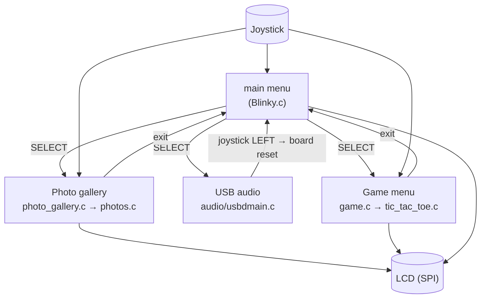
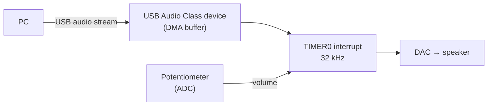

# Embedded Entertainment System

A bare-metal entertainment console for an ARM Cortex-M3 development board: a joystick-driven menu on the board's LCD launches a photo viewer, a USB speaker that plays audio from a PC, and a two-player Tic-Tac-Toe game.

## Tech Stack

Embedded C · ARM Cortex-M3 (NXP LPC1768, Keil MCB1700 board) · Keil uVision / MDK-ARM · CMSIS · USB Audio Class

## Features

- **Joystick menu**: up/down to move through Photos, Audio, and Game (wraps around), select to launch; the menu redraws when a module exits.
- **Photo viewer**: pick an image from a list, view it on the color LCD, and press left to go back.
- **USB speaker**: the board appears to a PC as a USB audio device; incoming audio is played through the on-board speaker, with live volume from the potentiometer.
- **Tic-Tac-Toe**: two players move a cursor with the joystick, with win/tie detection and scores kept across rounds.

## Architecture

The main loop polls the joystick and only reacts when its state changes, so a held button counts once. Photos and Game each run their own loop and return to the menu when the user exits.

**Audio path (interrupt-driven):**

## Technical Decisions & Challenges

- **Audio runs entirely in interrupts.** `begin_audio()` sets up the ADC, DAC, timer, and USB and returns immediately; a 32 kHz timer interrupt pulls each sample from the USB buffer, scales it by the potentiometer volume, and writes it to the DAC.
- **Leaving audio mode with a reset.** Because audio keeps running from interrupts, the joystick-LEFT exit inside the interrupt resets the board (`NVIC_SystemReset`) to return cleanly to the menu.
- **Edge-triggered input.** Comparing the current joystick reading with the previous one prevents a single press from moving the menu or game cursor several times.
- **Modular screens.** Each feature lives in its own source file behind a single entry function, so the menu only needs to know `begin_photo()`, `begin_audio()`, and `begin_game()`.

## What's in this repo

This repo contains the application code I wrote: the menu (`Blinky.c`), photo viewer, Tic-Tac-Toe game, and USB audio integration. `audio/usbdmain.c` is adapted from Keil's USB Audio Class example and keeps Keil's original notice. The board support files (LCD, joystick and LED drivers, USB stack, startup code, CMSIS) are Keil/NXP/ARM example code and aren't included because of their license, and the photo images aren't included because they're third-party art. Running the project requires the Keil MCB1700 board and Keil MDK.

## Next Steps

- Load images from an SD card instead of compiling them into flash.
- Let the user leave audio mode without a full reset by tearing down the USB and timer cleanly.
- Add a single-player Tic-Tac-Toe mode against a simple AI.
- Use interrupts instead of polling for the joystick to save power.

## License

[MIT](LICENSE) for my code. `audio/usbdmain.c` remains under Keil's original terms.
